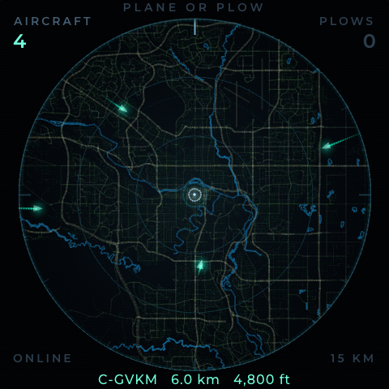
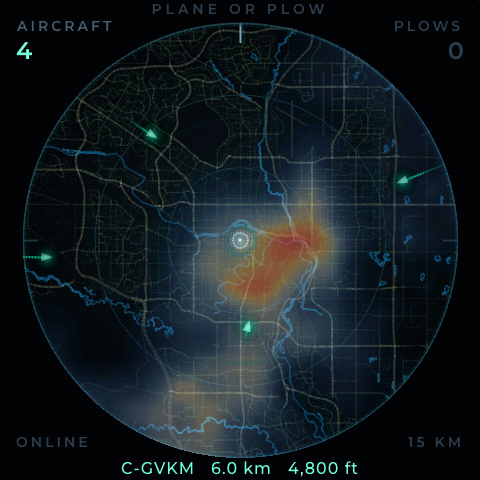

# Mile High Club

*Plane or Plow*

(Because you're either a plane… or you're getting plowed.)

An ambient radar scope for one house. It shows the aircraft and snowplows
within 15 km, and the snow on its way, on a 480×480 panel that sits in a room
and glows.

<p align="center">
  
  
</p>

<p align="center"><em>Demo location: downtown Calgary. Clear, and with precipitation.</em></p>

It started as a question. In winter you hear something outside — low, droning,
scraping — and you want to know whether that was a plane or a plow. This
answers it, and then keeps answering questions you didn't ask: what that
aircraft is, how high, whether the snow overhead is getting heavier, whether
anything is coming.

## What it shows

- **Aircraft** from [adsb.lol](https://adsb.lol), as triangles
  pointing along their track, dead-reckoned between fixes so they glide rather
  than jump. Callsign, distance and altitude for the nearest one. Ground
  traffic is filtered out — see below.
- **Snowplows** from [Alberta 511](https://511.alberta.ca), trailing the
  highway they're working.
- **Precipitation** from [Environment Canada GeoMet](https://eccc-msc.github.io/open-data/msc-geomet/readme_en/),
  cool for ordinary snow and heating through white into amber and red for
  heavy cells. Tap to replay the last hour.
- **An inbound cue** on the rim when something is heading your way from beyond
  the scope, breathing faster the closer it gets.
- **A basemap** from OpenStreetMap: rivers, range roads, town streets and
  highways, composited once at boot.

Two sonar rings expand from home on an 8.5 s cycle; contacts ping as a pulse
crosses their range. Brightness is scheduled — on at 07:30, off at 23:00,
easing over 1.6 s rather than stepping — and can be overridden by dragging the
left edge of the panel: full at the top, off at the bottom, with a level
indicator that fades after a moment. The override holds until the next
scheduled transition takes it back, so a manual dim never becomes a
permanently dark panel you have to remember to undo. The wall clock sits in
the bottom-left corner; `--:--` there means NTP has not synced, and since the
schedule depends entirely on the clock, that is the first thing to check if the
panel never dims.

## Hardware

| | |
|---|---|
| **Board** | ESP32-S3 with 16 MB flash and 8 MB OPI PSRAM |
| **Panel** | Sold as the **ESP32-4848S040**: 4.0" 480×480 IPS, ST7701 over an RGB565 parallel bus |
| **Touch** | GT911 capacitive, I²C |
| **Backlight** | Single PWM pin (GPIO 38) |
| **Power** | USB-C, ~5 V 500 mA |

PSRAM is not optional. The renderer keeps three full 480×480×2 framebuffers —
the static basemap, the basemap composited with precipitation, and the live
frame — which is 1.4 MB, plus LVGL's draw buffers.

Pin assignments live at the top of [`src/main.cpp`](src/main.cpp). They match
the common ESP32-4848S040 wiring; if your board differs, that's the file.

## Setup

The `espressif32` platform is pinned to 6.12.0 in
[`platformio.ini`](platformio.ini). Unpinned it resolves to 53.x / Arduino core
3.x, where the LEDC and Arduino_GFX APIs this uses have been renamed and the
build fails outright.

**1. Install [PlatformIO](https://platformio.org/install/cli)**

```bash
pip install platformio
```

**2. Configure it for your location**

One script geocodes the address, writes your credentials, and pulls the
basemap from OpenStreetMap:

```bash
python3 tools/configure.py \
    --address "Cochrane, Alberta" \
    --ssid    "MyNetwork" \
    --password "hunter2"
```

Or skip the geocoder:

```bash
python3 tools/configure.py --lat 51.0447 --lon -114.0719 --radius 20
```

That writes two files, both gitignored:

- `src/secrets.h` — WiFi, scope centre, radius, timezone
- `src/roads_data.h` — the basemap, simplified and classified

Re-run it whenever you move the scope, change the radius, or want fresher map
data; anything you don't pass again is preserved. `--skip-map` rewrites only
the credentials. `--tz` takes a POSIX timezone for the backlight schedule.

Get this right or the panel dims an hour off. Include a DST rule **only** if
your region actually observes DST — a bare offset is an hour slow all summer
where it does, and a DST rule is an hour slow all winter where it doesn't.
Alberta, for instance, has been on UTC-6 year round since 2026, so `MDT6` is
correct and `MST7MDT,...` is not. Verify with:

```bash
TZ="MDT6" date                 # your candidate
TZ="America/Edmonton" date     # the authority
```

They should agree in both July and January.

**3. Build and flash**

```bash
pio run -t upload
pio run -t monitor        # optional; 115200 baud
```

A healthy first boot looks like:

```
Reset reason: 1 (power-on)   free heap 294720
Background composited in 885 ms
Radar: 64x64 over 33 km, 10-frame history
Scope ready: 14.5 px/km, range 15 km
WiFi connected: 192.168.1.42 (RSSI -57)
Status: http://planeorplow.local/status
Mile High Club — scope ready
Radar tile 64x64 (33km): 1131 bytes, 1051 cells, 21 ms, heap 252472, stack left 12556
Airplanes: 5 in API, 5 in range, 5 tracked
```

Touch startup should report `GT911 ready` with its detected I²C address.
The driver uses the controller's existing configuration and does not try to
reset it through unavailable pins. Check `touch.available` and `touch.errors`
in `/status` if touch does not respond or I²C errors appear on serial.

## Checking on it

```bash
curl http://planeorplow.local/status
```

JSON: uptime, why the last run ended, heap, PSRAM, loop-task stack headroom,
WiFi state, contact counts, radar fetch and failure counters, backlight state,
touch health, download age, watchdog state and the previous run's last recorded
phase.
The endpoint uses maintained counters and a bounded JSON response, but serving
it still takes loop time and some temporary memory. Poll every 30–60 seconds
for a soak test. If mDNS does not resolve, use the IP printed on serial at boot.

`polls.aircraft_download_age_s` and `polls.plow_download_age_s` measure time
since the last successful download and parse; `null` means none has succeeded.
The corresponding `*_download_stale` flags turn on after 3 minutes for
aircraft and 10 minutes for plows. Contacts also expire after those intervals
without a new fix, including when requests keep failing.

These are **download ages, not observation timestamps**. The 511 map feed
does not include a timestamp for each position, and a newly downloaded
position can itself be old. `polls.plow_position_timestamp_available` is
therefore `false`. The separate 511 website tooltip has an `Updated` time;
the firmware does not fetch one tooltip per vehicle.

To find a leak, watch `heap.drift_since_settled` and `heap.min_free` over
hours. The baseline is captured *after* startup allocation finishes — measuring
from boot would read normal initialisation as a 50 KB leak.

`backlight.last_transition` records when the schedule last fired and at what
wall-clock time, so "did it dim last night?" is answerable the next morning
without a serial cable. `clock.valid` says whether the device has ever had a
real time at all.

`reset_reason` identifies the reset that started the current boot.
`diagnostics.watchdog_active` confirms that the loop task has joined the
60-second task watchdog. If the loop stops making progress, the watchdog
panics and restarts the device. `diagnostics.previous_run` then reports the
last phase and progress times saved in RTC RAM, when available. Epoch values
are zero until the clock has synced.

RTC breadcrumbs survive watchdog/software resets, **not loss of power**;
power-on and brownout boots discard them. There is no historical log stored
in flash. Serial emits a health line once a minute and operation errors as
they occur, so leave an external serial capture running when investigating
an intermittent fault. Preserve a status snapshot before unplugging a device
that still answers HTTP.

`touch.available` shows whether the GT911 is currently responding. The
`touch.errors`, `touch.invalid_frames` and `touch.recoveries` counters distinguish
transport/frame failures from later recovery; `touch.frames` counts accepted
frames, including release frames. Failed reads immediately release the LVGL
pointer, and retries back off from 250 ms to at most 5 seconds. A missing
controller can therefore recover without continuous polling or a stuck press.

## Regional scope

The snowplow and weather feeds are Albertan. Aircraft work anywhere
airplanes.live has coverage, and the basemap works anywhere OpenStreetMap does.
Elsewhere you'd want to swap two things:

- `PLOW_API_URL` in [`src/config.h`](src/config.h) for your local fleet feed
- The GeoMet radar in [`src/weather.cpp`](src/weather.cpp) for a regional
  equivalent — anything serving WMS tiles will fit the same shape

## How it's put together

| File | |
|---|---|
| `src/main.cpp` | Panel, touch and LVGL bring-up; the loop |
| `src/gfx_draw.cpp` | Anti-aliased RGB565 rasteriser: Wu lines, soft strokes, supersampled polygons, glows, symbol casings |
| `src/ambient.cpp` | The scene — projection, basemap, sonar pulses, contacts, trails, precipitation compositing |
| `src/weather.cpp` | GeoMet radar: bounded fetch, complete PNG validation/decode, history, replay, wide-area sweep |
| `src/network.cpp` | Aircraft and plow polling, contact tracking |
| `src/http_body.h` | Response-body size limits, idle timeout and total read deadline |
| `src/feed_http.cpp` | Single background HTTP worker and main-task completion handoff |
| `src/diagnostics.cpp` | Loop watchdog, RTC phase breadcrumbs and serial health reports |
| `src/touch_input.cpp` | Checked GT911 I²C reads, release handling and recovery backoff |
| `src/touch_frame.h` | Touch status, packet-length and coordinate validation |
| `src/hud.cpp` | The corner readouts |
| `src/backlight.cpp` | Scheduled brightness with eased transitions |
| `src/status.cpp` | The `/status` endpoint |
| `src/theme.h` | Every colour in one place |

Some notes on the parts that aren't obvious:

**The basemap is composited once, at boot.** Redrawing thousands of road
segments per frame was most of the original frame cost. Precipitation
composites into a second buffer on the radar's own 6-minute cadence. What
happens per display frame is one `memcpy`.

**The background gradient is dithered.** It spans about five distinct RGB565
levels across the radius, so quantising it directly draws visible concentric
banding. An 8×8 ordered dither hides it.

**Aircraft are dead-reckoned.** A fix every ~27 s would otherwise mean a plane
teleporting across the scope. Track and ground speed carry it between fixes at
30 fps, and its trail is resampled from the interpolated position.

**Water is the only saturated hue on the basemap.** Roads run a neutral
luminance ladder, warm-grey at the top, cooling as they recede — so a river
looks like a river and a highway looks like a road. Aircraft sit at hue 165,
clear of the amber plows at 35, the water at 205, and the precipitation ramp's
pink top end near 325.

**Ground traffic is filtered out.** ADS-B carries more than aircraft. In
emitter category set C, `C1` and `C2` are surface vehicles (emergency and
service) and `C3`-`C5` are obstacles; aircraft parked or taxiing report
`alt_baro` as the string `"ground"`. Neither flies over your house, and near an
airfield they dominate the scope.

`C0` is deliberately **not** filtered: it means "no emitter category
information", which real aircraft do report. Sweeping it up with the rest of
set C empties the scope of actual planes.

Both filters are on by default; flip `FILTER_SURFACE_VEHICLES` /
`FILTER_ON_GROUND` in [`src/config.h`](src/config.h) to see them again. For the
first five minutes after boot the serial log names every dropped contact and
why, so an empty scope can be explained rather than guessed at.

**SNTP starts only after WiFi is up.** Starting it during `setup()` — before
the radio associates — means the first resolution fails, and lwIP's retry
backoff can leave the clock unset for a long time. An unset clock means
`is_daytime()` has nothing to go on, holds its seeded "daytime", and the panel
never dims, silently. It is re-kicked every two minutes until it lands.

**HTTP reads cannot wait forever for an unfinished body.** In the pinned
Arduino core, `HTTPClient::getString()` can keep waiting when a server leaves
its connection open without sending the rest of the body. Aircraft and plow
polls used that path inside LVGL timers, stopping display and clock updates.
The replacement reader gives up after 2.5 seconds without data or 15 seconds
of body reading (9 seconds for radar), and rejects truncated responses. TLS
handshakes have an 8-second timeout; connection/header waits use 5 seconds;
redirects are limited to two. These are separate stage limits, not a promise
that the complete request takes at most 15 seconds. HTTP/TLS downloads run on
a dedicated background worker, so socket waits do not pause rendering or touch.
The worker and display task each join the 60-second watchdog.
Aircraft uses HTTP/1.1 (the provider rejects HTTP/1.0). Chunked bodies are
decoded under the same deadlines and size cap, with bounded framing metadata;
normal TLS closure is accepted for close-delimited bodies.

**One background download at a time.** Aircraft, plow and radar timers submit
to one shared worker on core 0. A busy slot is retried after 250 ms so timers
with the same period cannot starve each other. The response stays in PSRAM;
JSON/PNG decoding, contact updates and all LVGL operations remain on the main
task. The slot stays occupied until the completion callback returns and the
response is freed, preventing overlapping TLS/parser allocations. A radar
result arriving during replay waits in a separate decoded buffer until replay
finishes. Tapping starts replay and queues a refresh without waiting for it.
The title displays `RADAR REPLAY 1/10` and advances through the stored frames,
including when no precipitation is visible. This is precipitation radar,
not a cloud-cover image.

`feed_http` in `/status` reports worker readiness, watchdog state, active job,
request age and completed jobs. `render.frames` counts rendered frames since
startup and `render.max_frame_gap_ms` records the largest gap after setup;
they make it possible to check rendering while a network request is in flight.

**Large API metadata stays out of the contact document.** Body limits are
256 KiB for aircraft, 1 MiB for plows and 128 KiB for radar. Bodies are stored
in PSRAM, and JSON filters retain only fields the renderer uses. A measured
511 response was 258 KB, mostly repeated icon graphics that the device never
draws. Discarding those fields avoids substantial internal-heap pressure.
Radar PNGs are decoded from the complete bounded buffer, with expected
dimensions and decode completion checked before a frame is accepted.

**Touch failures cannot become arbitrary touch counts.** The former
TAMC_GT911 1.0.2 driver converted a failed `Wire.read()` into `0xff`, interpreted
it as 15 contacts and wrote past its five-contact array. On this build the
overwrite corrupted other members of the touch object, including its I²C
address. The replacement checks every transaction and read, rejects invalid
counts and coordinates, and reads only the first contact needed by LVGL.
It applies a 20 ms bus timeout and acknowledges frames without rewriting the
controller's factory configuration. The TAMC library is no longer linked.

The [October 23 freeze investigation](docs/2026-10-23-freeze-investigation.md)
records the evidence, remaining uncertainty and host regression test commands.
The [replay follow-up](docs/2026-10-23-replay-follow-up.md) records the live count
check and removal of synchronous download pauses.

**There is no heap-fragmentation figure in `/status`, deliberately.**
`heap_caps_get_largest_free_block()` walks and poison-checks every block under
a spinlock that disables interrupts, which the RGB panel's DMA cannot tolerate
— it panics the device.

## Regenerating the radar palette

`src/wx_ramp.h` maps radar tile pixels back to an intensity by sampling
Environment Canada's legend. It only needs regenerating if they change the
palette:

```bash
python3 tools/wx_ramp.py
```

## Credits

- Map data © OpenStreetMap contributors, [ODbL](https://www.openstreetmap.org/copyright)
- Radar © Environment and Climate Change Canada, [GeoMet open data](https://eccc-msc.github.io/open-data/)
- Aircraft via [adsb.lol](https://adsb.lol)
- Plows via [Alberta 511](https://511.alberta.ca)
- Built on [LVGL](https://lvgl.io), [Arduino_GFX](https://github.com/moononournation/Arduino_GFX),
  [pngle](https://github.com/kikuchan/pngle) and [ArduinoJson](https://arduinojson.org)

Be a good neighbour to the free APIs: the defaults poll one source every 20 s
and radar every 6 minutes, which is well within what they ask for. If you
shorten those intervals, you're the reason they get rate limited.

### A note on the ADS-B provider

This used to default to airplanes.live. It doesn't any more.

airplanes.live has disabled public API access — the endpoint returns HTTP 403
to everything except a short allowlist of `User-Agent` strings, one of which
happens to be the Arduino `HTTPClient` default. Building on that is building on
an accident, and there are
[well-documented reports](https://www.reddit.com/r/ADSB/comments/1vxwd46/)
of good-faith enquiries — including paying commercial ones — being met badly.
So this does not use their service and does not suggest you contact them.

[adsb.lol](https://adsb.lol) serves the identical `/v2/point/<lat>/<lon>/<nm>`
shape, asks only that you identify yourself with a real `User-Agent`, and is a
drop-in swap. [adsb.fi](https://adsb.fi) is another option; it works the same
way but uses `/api/v2/lat/<lat>/lon/<lon>/dist/<nm>`, so it needs the URL
builder in `network.cpp` adjusted rather than just the constant in
`config.h`.

All of these run on data volunteered by people with receivers on their roofs.
If you get value out of this, consider [feeding](https://adsb.lol/feed/) one.

## License

MIT — see [LICENSE](LICENSE).
